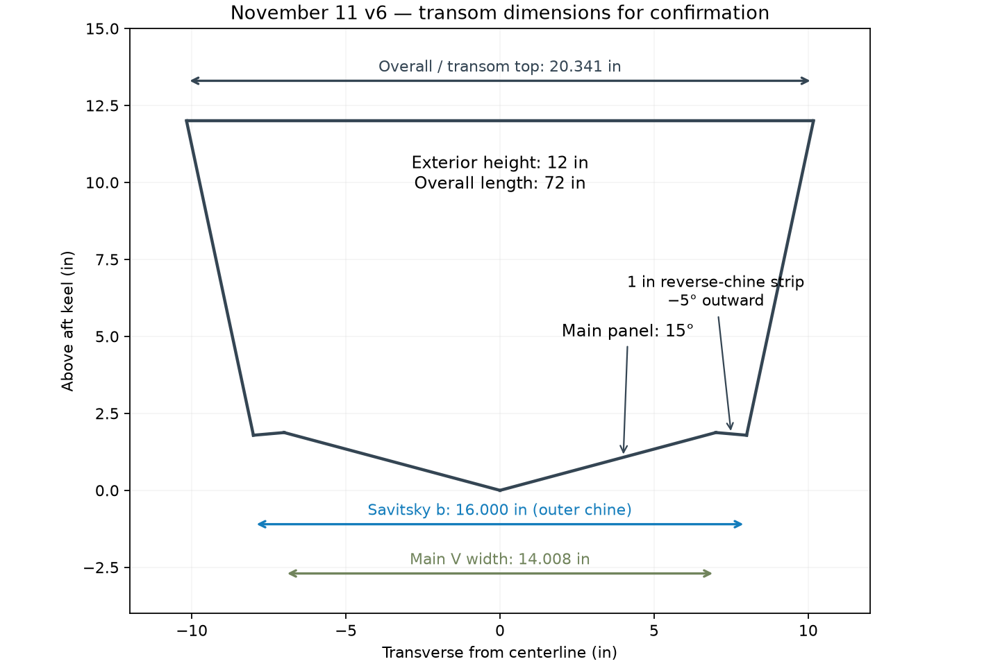

# November 11, 2026 — v6 Savitsky sensitivity

[Sensitivity notebook](sensitivity-analysis.ipynb) · [Proposed inputs](savitsky-inputs.json) · [Measured geometry](geometry-review.json) · [Sections](sections.csv)

**User-confirmed geometry and thrust setup; first sensitivity study complete.** The shaft/thrust angle is **11°**. [Results and limitations](results/RESULTS.md).

The study covers 0–30 mph, 26 cases and 806 speed/case rows. The notebook contains executed tables and charts. It checks source hashes and confirmation flags before solving.

## Confirmed dimensions

| Quantity | Measured value | Model use |
|---|---:|---|
| Overall length | 72.000 in | Hull length |
| Maximum overall width | 20.341 in | Envelope only; not Savitsky beam |
| Transom top width | 20.341 in | Envelope only |
| Exterior height | 12.000 in | CAD reference |
| Outer transom chine beam | **16.000 in** | Savitsky b |
| Main V transom width | 14.007611 in | Inner break, excludes reverse-chine strips |
| Main-panel transom deadrise | **15.000°** | Constant-V baseline |
| Reverse-chine strip, each side | 1.000 in along strip, −5.000° outward | Not explicitly modeled |
| Keel-to-outer-chine chord angle | 12.608842° | Separate approximation comparison |

The source is the exact [November 11 STEP used for hydrostatics](../../hydrostatics/v6-2026-11-11/hull%2011-11-26.step). Geometry and loading are referenced directly, without copying or changing the source files. Source hashes are checked before a study. The raw rim face is invalid, but all selected exterior faces are valid; [hydrostatics notes](../../geometry/v6-2026-11-11/README.md) explain the valid capped flotation envelope. Its artificial cap is not a Savitsky lifting surface.

[measure_geometry.py](measure_geometry.py) reuses the v4 approach of exact CAD edge evaluation, adapted to the v6 faces already reviewed for hydrostatics. It measures exterior transom and longitudinal bottom boundaries, excluding internal shell surfaces, ribs and mounts. Run it with the CAD dependencies from `hull/hydrostatics/requirements-geometry.txt`; it does not solve hydrodynamics. Pass `--plot` to regenerate the transom drawing with matplotlib.

## Longitudinal variation and scope

Aft sections sampled from 0 to 18 inches have the same measured width and chord angles, with a straight keel. Forward keel rocker appears beyond that: keel rise at 24 in is 0.000888 in, at 36 in is 0.034656 in, and continues increasing forward. The full exact-edge samples are in `sections.csv`. No uniform aft length has been assigned to the model. A complete cross-section/prismaticity assessment would be needed before using one as an applicability cutoff.

All solved points therefore retain the existing equivalent-hull geometry flag. The constant-V engine does not explicitly resolve reverse-chine lift/drag or varying sections. Both the main-panel and outer-chine-chord angles are approximations. A measured CAD dimension alone does not validate a Savitsky prediction.

## Loading and thrust setup

Reuse the [v6 hydrostatics mass table](../../hydrostatics/v6-2026-11-11/component-masses.csv): seven supplied rows totaling **153.595 lb / 69.669520 kg**. Thirteen missing weights are excluded as authorized. The mass-weighted CG is **X 0.065822 in, Y 27.308361 in, Z 5.540674 in**, with Y forward from transom and Z above aft keel. The symmetric Savitsky model uses longitudinal and vertical CG; it omits the small transverse offset.

Confirmed thrust setup: reuse v4's two propellers and thrust-line reference point, with the user-specified **11° shaft/thrust angle**, with a point on the thrust line 4.824 in aft of transom and 1.292 in below aft keel. Motor component CGs do not establish a shaft line; the changed motor positions in v6 are not substituted for thrust coordinates.

Static hydrostatics trim is not supplied as running trim. The Savitsky engine solves running trim and wetting at each speed; positive running trim means bow up. Effective power is towing power, not motor/battery power. No displacement/transition resistance, appendage drag, propeller interaction, waves or dynamic-stability model is included. The low-speed engine cutoff is not a planing-onset prediction.

## Run

Use the existing hydrostatics Python environment, or install the [Savitsky notebook dependencies](../engine/requirements-notebook.txt). Open the notebook and run from top to bottom. It reuses `savitsky_sensitivity.py`, `display_units.py` and the current equation notebook; equations are unchanged. User-confirmed values and review flags are recorded in `savitsky-inputs.json`.

The default speed grid is 0–30 mph in 1-mph steps. Editable controls compare beam, mass, longitudinal/vertical CG, deadrise and thrust angle, plus the outer-chine-chord approximation and two CG scenarios. Empty a variation list to disable it. Length and thrust-position controls remain available. Charts show resistance, effective power, running trim, wetting, pressure/friction resistance and normalized sensitivity, with model-status flags and exact-value tables.

Each export uses a new timestamped folder under `results/sensitivity/`, saving `study.json`, inch-based `curves.csv`, `sensitivities.csv` and displayed PNG charts. Existing results are preserved. Set `EXPORT_NAME = None` to disable export. Changing the hydrostatics STEP or loading requires refreshing the measurements/baseline before running.
