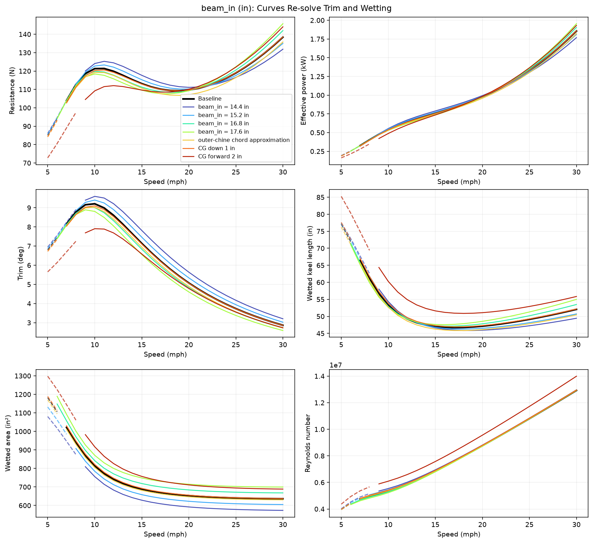
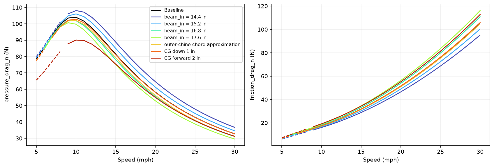
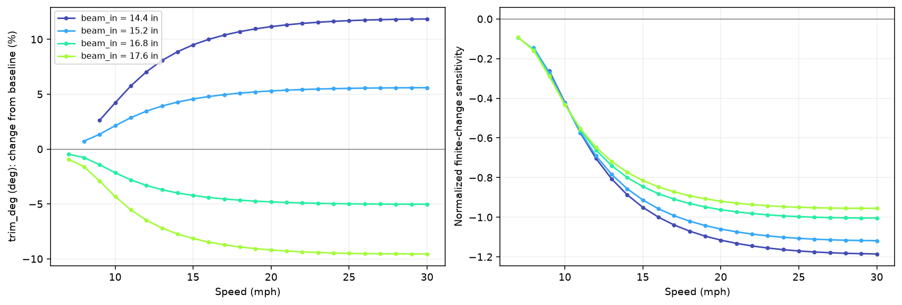

# November 11 v6 — Savitsky sensitivity results

[Executed notebook](../sensitivity-analysis.ipynb) · [Saved study](sensitivity/study-20261112T010624310036Z/study.json) · [Curves CSV](sensitivity/study-20261112T010624310036Z/curves.csv) · [Sensitivity CSV](sensitivity/study-20261112T010624310036Z/sensitivities.csv)

The completed 0–30 mph sweep includes **26 cases, 806 speed/case rows and 6,820 sensitivity records**. Geometry and partial loading reuse the v6 hydrostatics sources directly, with source hashes in the saved configuration. The equation engine is unchanged; its fingerprint is saved in the study JSON.

Confirmed baseline: **72 in length, 16 in outer chine beam, 15° main-panel deadrise, 153.595 lb, 11° shaft/thrust angle and two propellers**. The reused point on the thrust line is 4.824 in aft of transom and 1.292 in below aft keel. CG is 27.308361 in forward and 5.540674 in above aft keel. Thirteen blank component masses are excluded as authorized.

## Baseline estimates

| Speed (mph) | Running trim, bow up (°) | Resistance (N) | Effective power (kW) | Wetted keel (in) |
|---:|---:|---:|---:|---:|
| 10 | 9.209 | 121.304 | 0.542 | 53.303 |
| 15 | 7.138 | 113.124 | 0.759 | 47.003 |
| 20 | 5.071 | 109.650 | 0.980 | 47.125 |
| 25 | 3.732 | 118.950 | 1.329 | 49.133 |
| 30 | 2.864 | 138.411 | 1.856 | 52.059 |

These are **equivalent-V estimates**. Positive running trim means bow up; it is solved independently of the static hydrostatics attitude. Effective power is towing power, not electrical/motor power.

The baseline is within the engine's empirical screen at 7–30 mph. At 5–6 mph the engine returns outside-limit estimates. At 1–4 mph displacement/transition resistance is unmodeled; the zero-speed row is a static bookkeeping point. None of these cutoffs predicts planing onset.

**Every solved point retains the geometry-approximation flag.** Reverse-chine lift/drag and forward rocker are not explicitly resolved. No uniform aft length is assigned. Passing the empirical screen does not validate this hull approximation or establish dynamic stability.

## Plots and comparisons

The displayed parameter defaults to beam, with the baseline in black. Additional curves show the 12.608842° outer-chine-chord approximation, CG down 1 in and CG forward 2 in. The chord is an imaginary keel-to-outer-chine line, not the actual 15° main-panel angle. Dashed portions are outside the empirical screen. Other editable variation lists include mass, longitudinal/vertical CG, deadrise and thrust angle.

## Verification

All notebook cells completed and figures were visually checked. Geometry/loading hashes match the hydrostatics inputs. All solved scenarios retain their convergence residuals and applicability flags in the CSV/JSON. The ten existing Savitsky/display-unit tests passed. Existing v4 notebook edits and historical runs were preserved.
