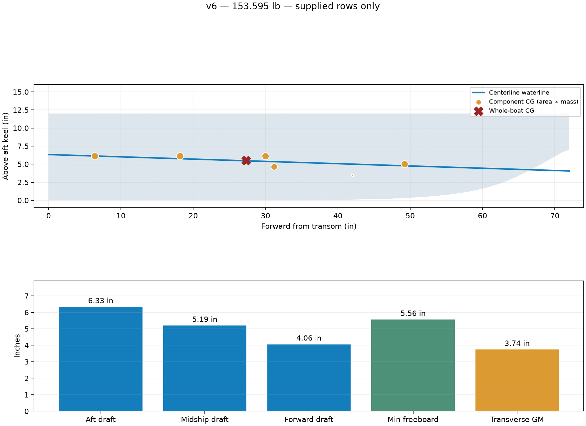

# v6 NavalToolbox hydrostatics

**Supplied-row loading — blank component weights excluded by explicit opt-in.**

- Total mass: 153.595 lb
- Aft draft: 6.330 in
- Midship draft: 5.194 in
- Forward draft: 4.059 in
- Trim (positive bow down): -1.807 deg
- Heel: 0.604 deg
- Minimum rim freeboard: 5.560 in
- Waterline length: 66.707 in
- Wetted area: 1566.305 in²
- Initial transverse GM: 3.740 in

Whole-boat CAD CG (X/Y/Z): 0.06582, 27.30836, 5.54067 in.

## Assumptions and loading scope

- Water density 998.2 kg/m³.
- Loading CSV: X transverse; Y forward from transom; Z above aft keel. Naval X = CAD Y; naval Y = -CAD X; Z unchanged. Confirm against the reviewed geometry.
- Dry interior; artificial cap at 12-inch rim. No additional tube or appendage buoyancy. Invalid when rim immersed.
- Every filled CSV row is included independently; repeated component IDs are separate rows.
- Blank component rows excluded by explicit partial-loading opt-in.
- Static equilibrium and initial GM only; no speed, planing, waves or large-angle stability calculation.

Excluded blank rows: Fiberglass resin fairing and paint, Port tube, Starboard tube, Backbone and frame, Baseboard, Port motor controller, Starboard motor controller, Electronics enclosure, Electronics and power distribution, Sensor tower and sensors, Wiring connectors and cables, Fasteners mounts and adhesives, Aft payload.

## Numerical checks

Mesh/STEP volume difference: 0.00814%. Mass-balance error: 0.00371%. Maximum analytical-box error: 0.00610%. These checks establish numerical consistency, not physical validation.

[CSV results](hydrostatics.csv) · [Full inputs, assumptions and checks](study.json) · [Original loading snapshot](component-masses-input.csv)
